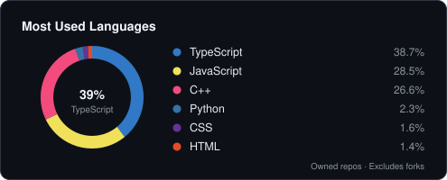
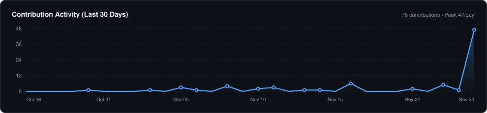

### Hi, I'm Krishna Singh

Undergrad at NIT Jalandhar. I write C++, Python, and TypeScript—mostly working on backend services, full-stack apps, and performance-oriented tooling.

 

  <picture>
    <source media="(prefers-color-scheme: dark)" srcset="https://raw.githubusercontent.com/Krishna27Singh/Krishna27Singh/output/stats-dark.svg" />
    <source media="(prefers-color-scheme: light)" srcset="https://raw.githubusercontent.com/Krishna27Singh/Krishna27Singh/output/stats-light.svg" />
    
  </picture>
  <picture>
    <source media="(prefers-color-scheme: dark)" srcset="https://raw.githubusercontent.com/Krishna27Singh/Krishna27Singh/output/langs-dark.svg" />
    <source media="(prefers-color-scheme: light)" srcset="https://raw.githubusercontent.com/Krishna27Singh/Krishna27Singh/output/langs-light.svg" />
    
  </picture>
    
  <picture>
    <source media="(prefers-color-scheme: dark)" srcset="https://raw.githubusercontent.com/Krishna27Singh/Krishna27Singh/output/activity-dark.svg" />
    <source media="(prefers-color-scheme: light)" srcset="https://raw.githubusercontent.com/Krishna27Singh/Krishna27Singh/output/activity-light.svg" />
    
  </picture>

 

### Stack

  

 

  <picture>
    <source media="(prefers-color-scheme: dark)" srcset="https://raw.githubusercontent.com/Krishna27Singh/Krishna27Singh/output/github-snake-dark.svg" />
    <source media="(prefers-color-scheme: light)" srcset="https://raw.githubusercontent.com/Krishna27Singh/Krishna27Singh/output/github-snake.svg" />
    
  </picture>

