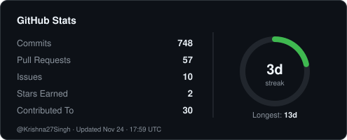
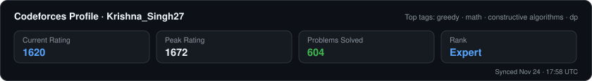

<h1>Krishna Singh</h1>

  <strong>Backend, Systems &amp; Full-Stack Engineer · Competitive Programmer</strong> 
  Building low-latency C++/Python systems, retrieval pipelines, and developer tools.

  
  
  
  

---

### Featured Project

<table>
  <tr>
    <td>
      <a href="https://github.com/Krishna27Singh/BridgeCF"><strong>BridgeCF — Adaptive Codeforces Hint Engine</strong></a>
      &nbsp;·&nbsp;
      <a href="https://bridgecf-api.onrender.com/demo">Live Demo</a>
      &nbsp;·&nbsp;
      <a href="https://github.com/Krishna27Singh/BridgeCF/releases/latest">Chrome Extension</a>
        
      A Chrome MV3 extension and hybrid retrieval backend that analyzes your Codeforces submission history to isolate missing prerequisite concepts, recommend calibrated unsolved bridge problems, and generate progressive spoiler-free hints.
        
      <code>C++17</code> · <code>Python</code> · <code>FastAPI</code> · <code>FAISS (384-dim)</code> · <code>SQLite</code> · <code>Shadow DOM</code> · <code>Docker</code> · <code>GitHub Actions</code>
    </td>
  </tr>
</table>

---

### Engineering Metrics

  <picture>
    <source media="(prefers-color-scheme: dark)" srcset="https://raw.githubusercontent.com/Krishna27Singh/Krishna27Singh/output/stats-dark.svg" />
    <source media="(prefers-color-scheme: light)" srcset="https://raw.githubusercontent.com/Krishna27Singh/Krishna27Singh/output/stats-light.svg" />
    
  </picture>
  <picture>
    <source media="(prefers-color-scheme: dark)" srcset="https://raw.githubusercontent.com/Krishna27Singh/Krishna27Singh/output/langs-dark.svg" />
    <source media="(prefers-color-scheme: light)" srcset="https://raw.githubusercontent.com/Krishna27Singh/Krishna27Singh/output/langs-light.svg" />
    
  </picture>
    
  <a href="https://codeforces.com/profile/Krishna_Singh27">
    <picture>
      <source media="(prefers-color-scheme: dark)" srcset="https://raw.githubusercontent.com/Krishna27Singh/Krishna27Singh/output/cf-dark.svg" />
      <source media="(prefers-color-scheme: light)" srcset="https://raw.githubusercontent.com/Krishna27Singh/Krishna27Singh/output/cf-light.svg" />
      
    </picture>
  </a>

---

### Tech Stack

  
<strong>Languages</strong> 
    
  

  
<strong>Backend, AI &amp; Data</strong> 
    
  

  
<strong>Frontend, Infra &amp; Tools</strong> 
    
  

---

### Contribution Graph

  <picture>
    <source media="(prefers-color-scheme: dark)" srcset="https://raw.githubusercontent.com/Krishna27Singh/Krishna27Singh/output/github-snake-dark.svg" />
    <source media="(prefers-color-scheme: light)" srcset="https://raw.githubusercontent.com/Krishna27Singh/Krishna27Singh/output/github-snake.svg" />
    
  </picture>

