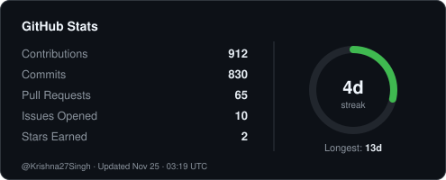
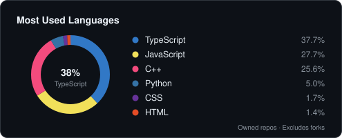
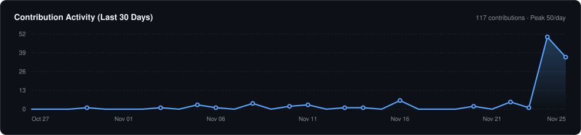

### Hi, I'm Krishna Singh

Undergrad at NIT Jalandhar. I write C++, Python, and TypeScript mostly working on backend services, full-stack apps, and performance oriented tooling.

---
<!-- ACTIVITY_TABLE:END -->

 

  <picture>
    <source media="(prefers-color-scheme: dark)" srcset="https://raw.githubusercontent.com/Krishna27Singh/Krishna27Singh/output/stats-ring-dark.svg" />
    <source media="(prefers-color-scheme: light)" srcset="https://raw.githubusercontent.com/Krishna27Singh/Krishna27Singh/output/stats-ring-light.svg" />
    
  </picture>
  <picture>
    <source media="(prefers-color-scheme: dark)" srcset="https://raw.githubusercontent.com/Krishna27Singh/Krishna27Singh/output/langs-donut-dark.svg" />
    <source media="(prefers-color-scheme: light)" srcset="https://raw.githubusercontent.com/Krishna27Singh/Krishna27Singh/output/langs-donut-light.svg" />
    
  </picture>
    
  <picture>
    <source media="(prefers-color-scheme: dark)" srcset="https://raw.githubusercontent.com/Krishna27Singh/Krishna27Singh/output/activity-graph-dark.svg" />
    <source media="(prefers-color-scheme: light)" srcset="https://raw.githubusercontent.com/Krishna27Singh/Krishna27Singh/output/activity-graph-light.svg" />
    
  </picture>

---

### Tech Stack

**Languages**

  

**Backend & Databases**

  

**Frontend & AI / ML**

  

**DevOps & Tools**

  

---

  <picture>
    <source media="(prefers-color-scheme: dark)" srcset="https://raw.githubusercontent.com/Krishna27Singh/Krishna27Singh/output/github-snake-dark.svg" />
    <source media="(prefers-color-scheme: light)" srcset="https://raw.githubusercontent.com/Krishna27Singh/Krishna27Singh/output/github-snake.svg" />
    
  </picture>

